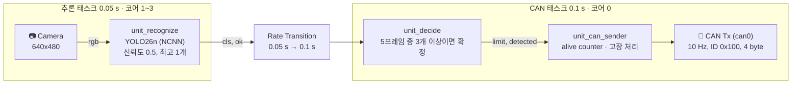

# sign_detector

**카메라로 속도제한 표지판을 인식해, 확정된 제한속도를 CAN으로 보내는 Raspberry Pi 임베디드 소프트웨어**


-blue)


- 30 / 60 / 90 / 120 km/h 표지판을 YOLO26n(NCNN)으로 인식하고, 최근 5프레임 다수결로 확정합니다.
- 확정된 제한속도를 **0.1초마다** CAN(ID `0x100`)으로 보냅니다. 인식이 느려지거나 CAN이 고장 나도 주기는 지켜집니다.
- 요구사항 → 모델 설계 → MIL 테스트 → CI(Process Advisor) → 코드 생성 → Pi 배포 → HIL 테스트를 **MATLAB/Simulink 한 도구 체인**으로 진행했습니다.

## HIL 결과 요약

Raspberry Pi에서 실제로 실행하고 CAN 송신을 기록해 측정한 값입니다 (2026-11-10).

| 항목 | 요구사항 | 실측 |
|---|---|---|
| CAN 송신 주기 | 100 ms ± 10 ms | 평균 **100.0 ms** (98.2 ~ 101.7 ms), CPU 4코어 부하 중 최대 105.1 ms |
| 처리 속도 | 평균 15 FPS 이상 | **19 FPS** (추론 1회 52 ms) |
| 60초 연속 송신 | 누락 없음 | 누락 **0** |
| CAN 고장 후 복구 | 0.5 s 안에 재개 | **0.15 s** (재시작 없이 자동 재개) |
| 인식 정지 감지 | 1 s 이상 결과 없으면 송신 중지 | 0.86 s 뒤 중지, 재개 0.23 s |
| 시작 상태 | 첫 결과 전 상태 0, 10 s 안에 결과 없으면 중지 | 첫 프레임 1.2 s, 상태 0 → 1. 모델이 없으면 10 s 뒤 중지 |

---

## 동작 방식



| 모델 | 하는 일 | 요구사항 |
|---|---|---|
| `unit_recognize` | 영상 1프레임 → 표지판 클래스. NCNN C++ 추론(`pi/ncnn/ncnn_infer.cpp`, `coder.ceval`) + 후처리(신뢰도 0.5, 최고 1개) | SWR-01, 21 |
| `unit_decide` | 최근 5프레임 중 같은 표지판이 3개 이상이면 확정하고, 다음 확정까지 유지 | SWR-02, 03, 22 |
| `unit_can_sender` | CAN 메시지 구성, alive counter, 인식 정지 · 시작 대기 · CAN 고장 처리 | SWR-04, 11, 31~34 |
| `sign_detector` | 최상위 모델. 위 세 모델을 참조하고 카메라 · 시계 · 태스크 주기를 연결 | 전체 |

### 설계 포인트

- **두 개의 주기 태스크**: 기본 스텝 0.025 s, 추론 0.05 s, CAN 0.1 s. 추론이 늦어져도 CAN 주기는 밀리지 않습니다 (SWR-04).
- **코어 분리**: 추론은 코어 1~3, CAN 송신은 코어 0.
- **시뮬레이션 / Pi 자동 전환**: Camera와 CAN Tx는 Variant Subsystem이라, 시뮬레이션에서는 포트 · 신호를, 코드 생성에서는 Pi 블록을 씁니다.
- **모델 미리 읽기**: 초기화 때 `ncnn_infer_preload()`가 NCNN 모델을 읽어 둬서 첫 추론이 송신 주기를 밀지 않습니다.

### CAN 메시지 (can0, 500 kbit/s, ID `0x100`, 4 byte)

| Byte | 내용 |
|---|---|
| 0 | 제한속도 km/h (0 = 모름, 30 / 60 / 90 / 120) |
| 1 | 확정 여부 (0 / 1) |
| 2 | alive counter (0 ~ 255, 송신할 때마다 1 증가) |
| 3 | 상태 (0 = 첫 인식 결과 전, 1 = 인식 동작 중) |

### 파라미터 (`models/sign_detector.sldd`)

| 이름 | 값 | 의미 |
|---|---|---|
| `INFER_PERIOD` | 0.05 s | 추론(카메라) 주기 |
| `CAN_PERIOD` | 0.1 s | CAN 송신 주기 (SWR-04) |
| `CONF_THRES` | 0.5 | 신뢰도 기준 (SWR-01) |
| `VOTE_N`, `VOTE_K` | 5, 3 | 최근 N프레임 중 K개 이상이면 확정 (SWR-02) |
| `STALL_SEC` | 1 s | 이 시간 동안 새 결과가 없으면 인식 정지 (SWR-32) |
| `BOOT_SEC` | 10 s | 시작 후 이 시간 안에 첫 결과가 없으면 송신 중지 (SWR-34) |

---

## 빠른 시작

Pi 없이 PC에서 MIL 테스트까지 돌려 보는 순서입니다.

1. 저장소를 받습니다.
   ```bash
   git clone https://github.com/kimdon-dot/sign_detector.git
   ```
2. [Tencent/ncnn 릴리스 20261020](https://github.com/Tencent/ncnn/releases/tag/20261020)에서 `ncnn-20261020-windows-vs2026.zip`을 받아 `cache/ncnn_win/` 아래에 풉니다 (PC 시뮬레이션용, [폴더 구조](#폴더-구조) 참고).
3. MATLAB R2026b에서 프로젝트를 엽니다. 시작 스크립트가 NCNN 모델 폴더(`cache/best_ncnn_model`)를 자동으로 설정합니다.
   ```matlab
   openProject('sign_detector.prj');
   ```
4. 테스트를 실행합니다.
   ```matlab
   sltest.testmanager.load('tests/unit_decide.mldatx');   % 또는 Test Manager에서 열기
   sltest.testmanager.run;
   ```
   엑셀에서 테스트 케이스를 바꿨으면 `make_unit_cases('tests/unit_decide.xlsx', 'tests/unit_decide.mldatx')`로 테스트 파일을 다시 만듭니다.

> `unit_decide`, `unit_can_sender`는 NCNN 없이도 돌아갑니다. `unit_recognize`와 최상위 `sign_detector` 테스트는 2번이 필요합니다.

---

## 폴더 구조

```
sign_detector/
├── sign_detector.prj            MATLAB 프로젝트 (열면 pi/ncnn/set_ncnn_model_dir.m 자동 실행)
├── processmodel.m               Process Advisor 파이프라인 (CI 전체 단계 정의)
├── requirements/                요구사항 (requirements.slreqx)
├── models/                      Simulink 모델 4개 + 데이터 사전(.sldd), 구현 링크(~mdl.slmx)
├── checks/model_standards.json  Model Advisor 검사 목록
├── pi/
│   ├── ncnn/ncnn_infer.cpp/.h     NCNN 추론 (Pi · PC 시뮬레이션 공통), HIL 측정용 로그 · 훅
│   ├── pi_postcodegen.m           코드 생성 후 Pi 빌드 정보 수정 (NCNN 링크, C++20)
│   └── libcamera_compat.h         Pi 카메라 블록과 libcamera 0.7 호환
├── tests/
│   ├── <모델>.xlsx                테스트 케이스 정의 (시트 1개 = 테스트 1개, 시각별 입력 · 기대값)
│   ├── <모델>.mldatx              Simulink Test 파일 (엑셀에서 생성)
│   ├── make_unit_cases.m          엑셀 → 테스트 파일 생성
│   ├── make_recognize_inputs.m    인식 테스트용 이미지 입력(.mat) 생성
│   ├── <모델>_inputs/             이미지 입력 (.mat, 시트별)
│   └── hil/
│       ├── HilTest.m              HIL 테스트 7개 (요구사항별 판정)
│       ├── runOnPi.m              SSH로 Pi에서 명령 실행 (HilTest가 씀)
│       ├── DeployToPi.m           Process Advisor 태스크: Pi 빌드 · 배포
│       ├── RunHilTests.m          Process Advisor 태스크: HIL 테스트 실행
│       └── results/               HIL 측정 원본 (.mat, 검증 근거)
├── cache/
│   ├── best_ncnn_model/           학습된 YOLO26n NCNN 모델 (model.ncnn.param/.bin)   ← Git 포함
│   ├── dataset/raw/               인식 테스트용 샘플 이미지                           ← Git 포함
│   ├── ncnn_win/                  Windows용 NCNN 라이브러리 (직접 받기)               ← Git 제외
│   └── sign_detector/             Simulink 캐시 · 코드 생성 · 빌드 결과 (자동 생성)    ← Git 제외
├── PA_Results/                  Process Advisor 결과 (자동 생성)                      ← Git 제외
└── resources/project/           MATLAB 프로젝트 메타데이터 (직접 수정하지 않음)
```

---

## 요구사항

| ID | 이름 | 요약 |
|---|---|---|
| SWR-01 | 인식 | 30/60/90/120 표지판을 실시간 인식. 신뢰도 0.5 이하는 버리고, 프레임당 최고 1개만 사용 |
| SWR-02 | 확정 | 최근 5프레임 중 같은 표지판 3개 이상이면 확정. 인식 정지 때 기록 초기화 |
| SWR-03 | 제한속도 유지 | 다음 확정까지 유지. 시작 시 0(모름) |
| SWR-04 | CAN 송신 | 0.1 s ±10 ms 주기. 추론 주기와 독립 |
| SWR-11 | CAN 메시지 | can0 500 kbit/s, ID 0x100, 4 byte: 제한속도 · 확정 여부 · alive · 상태 |
| SWR-21 | 처리 속도 | 결과 간격 0.2 s 이하, 연속 10 s 구간 평균 15 FPS 이상 |
| SWR-22 | 응답 시간 | 처음 인식부터 0.5 s 안에 확정(시작 직후 · 정지 해제 직후 0.8 s), 다음 송신에 반영 |
| SWR-31 | 생존 확인 | alive counter. 송신 실패 주기에도 증가, 송신하지 않는 주기에는 증가하지 않음 |
| SWR-32 | 인식 정지 | 1 s 이상 새 결과가 없으면 송신 중지, 새 결과가 나오면 재개 |
| SWR-33 | 고장 시 동작 | CAN 고장에도 인식 계속. can0 복구 시 재시작 없이 0.5 s 안에 재개 |
| SWR-34 | 시작 상태 | 첫 결과 전에는 상태 0으로 송신. 10 s 안에 결과가 없으면 송신 중지 |
| SWR-35 | 운영 조건 | (정보) can0을 500 kbit/s로 올려 두고, 버스에 ACK하는 수신 노드가 있어야 함 |

---

## 검증

### 단계

| 단계 | 내용 | 도구 |
|---|---|---|
| 정적 검사 | Model Advisor(HISM 기반, `checks/model_standards.json`), 유지보수성 메트릭, 클론 탐지 | Simulink Check |
| MIL 단위 | 모델별 베이스라인 테스트. 엑셀 시트 하나가 테스트 하나: unit_decide 25, unit_can_sender 7, unit_recognize 4 | Simulink Test |
| MIL 통합 | 최상위 모델로 사진 입력 → CAN 출력까지 2개 | Simulink Test |
| 커버리지 · 테스트 메트릭 | 테스트 결과 병합, 요구사항 기반 테스트 메트릭 | Simulink Coverage, Simulink Check |
| 코드 생성 | Embedded Coder (ERT, C++) | Embedded Coder |
| 배포 | Pi 빌드(참조 모델 강제 재빌드) | Raspberry Pi Blockset |
| HIL | Pi에서 실제로 실행하고 can1에서 송신을 기록해 판정, 7개 | MATLAB Unit Test |

모든 단계는 `processmodel.m`의 Process Advisor 파이프라인 하나로 묶여 있고, 입력이 바뀐 태스크만 다시 실행됩니다. 요구사항마다 구현 위치(Implement)와 검증 테스트(Verify)를 Requirements Toolbox 링크로 연결했습니다.

### HIL 구성

```
 Raspberry Pi
   sign_detector.elf ──▶ can0 ═══ 선 ═══ can1 ──▶ candump -t a (수신 기록)
   시나리오(HilTest.m가 runOnPi로 SSH 실행): CPU 부하, can0 down/up, 모델 파일 숨김, 인식 정지 파일
```

- 시각은 모두 Pi 시계로 잽니다(`candump -t a`, `date +%s.%N`). 네트워크 지연이 섞이지 않습니다.
- 처리 속도와 인식 정지는 `ncnn_infer.cpp`의 Pi 빌드 전용 기능을 씁니다: 5초마다 FPS 로그, `/tmp/stall_infer`가 있는 동안 결과 안 냄.

### 요구사항별 검증

| ID | 구현 위치 | MIL 테스트 | HIL 테스트 |
|---|---|---|---|
| SWR-01 | `unit_recognize/Subsystem` | 6 | – |
| SWR-02 | `unit_decide/Fcn` | 18 | – |
| SWR-03 | `unit_decide/Fcn` | 2 | – |
| SWR-04 | `sign_detector/Rate Transition`, `unit_can_sender/Fcn`, `CAN Tx/Pi CAN` | 5 | `normalOperation`, `periodUnderCpuLoad` |
| SWR-11 | `unit_can_sender/Fcn`, `CAN Tx/Pi CAN` | 4 | `normalOperation` |
| SWR-21 | `unit_recognize/Subsystem/Infer`, `ncnn_infer.cpp` ※ | – | `processingRate` |
| SWR-22 | `sign_detector/Rate Transition`, `unit_decide/Fcn` | 7 | – (미측정) |
| SWR-31 | `unit_can_sender/Fcn` | 4 | `normalOperation`, `canFailureKeepsRunning`, `stallStopsSending` |
| SWR-32 | `sign_detector/Infer_status`, `unit_can_sender/Fcn` | 1 | `stallStopsSending` |
| SWR-33 | `unit_can_sender/Fcn`, `CAN Tx/Pi CAN` | 1 | `canFailureKeepsRunning` |
| SWR-34 | `sign_detector/Infer_status`, `unit_can_sender/Fcn` | 3 | `bootStatus`, `noModelStopsAfterBootTimeout` |

실측값은 맨 위 [HIL 결과 요약](#hil-결과-요약)에 있습니다. MIL 테스트 수는 Verify 링크 수라 합계가 38보다 큽니다.<br/>
※ SWR-21은 Implement 링크가 아직 없습니다.

### HIL에서 찾아 고친 문제

| 증상 | 원인 | 조치 | 결과 |
|---|---|---|---|
| 시작 직후 CAN 간격 150~366 ms | 첫 추론 안에서 NCNN 모델 파일을 읽느라 태스크가 밀림 | 모델 초기화에서 미리 읽기(`ncnn_infer_preload`) | 시작 직후도 100 ms |
| CAN 평균 간격 105 ms | 기본 스텝이 추론 주기(0.05 s)라 추론이 넘치면 CAN도 밀림 | 기본 스텝 0.025 s, CAN을 독립 하위 주기 태스크로 | 평균 100.0 ms |
| CAN 고장 후 재개 동작이 요구사항과 다름 | 요구사항은 "재시작까지 정지", 실제 Pi CAN 블록은 can0 복구 시 자동 재개 | 실측에 맞춰 SWR-33 수정 (근거를 Rationale에 기록) | 0.15 s 뒤 재개 |
| C++만 고친 뒤 배포해도 Pi에 예전 코드 | Simulink 증분 빌드가 외부 C++ 변경을 알아채지 못함 | `DeployToPi`가 참조 모델까지 강제 재빌드 | – |

---

## 실행 방법

### 준비

**PC**: MATLAB R2026b (Simulink, Embedded Coder, Simulink Test, Simulink Coverage, Simulink Check, Requirements Toolbox, Raspberry Pi Blockset) + [빠른 시작](#빠른-시작)의 NCNN

**Raspberry Pi** (Raspberry Pi OS, Debian 13) — 배포 · HIL에만 필요
- NCNN `/usr/local/lib/libncnn.a`, `/usr/local/include/ncnn/`, 그리고 `pi/libcamera_compat.h`를 `/usr/local/include/`에 복사
- `cache/best_ncnn_model/`을 `/home/pi/sign_detector_project/best_ncnn_model/`로 복사
- can0(송신) ↔ can1(수신)을 선으로 연결
- MATLAB에 `raspberrypi` 연결 정보 저장 (배포용), PC에서 `ssh pi`가 비밀번호 없이 접속 (HIL의 `runOnPi`용)

### 전체 파이프라인 (Process Advisor)

```matlab
processAdvisorWindow                              % 앱에서 Run All
runprocess('GenerateJUnitForProcess', true);      % 또는 CI에서
```

결과는 `PA_Results/`에 남습니다(HIL: `PA_Results/hil/`, 측정 원본: `tests/hil/results/`). Pi 없이 돌리려면 `processmodel.m`에서 `includeHilTasks = false`.

### HIL만 따로

```matlab
results = runtests('HilTest', 'Tag', 'basic');   % Pi 설정을 바꾸지 않는 5개 (약 4분)
results = runtests('HilTest');                    % 고장 시나리오 포함 7개 (약 5분)
results = runtests('HilTest/bootStatus');         % 테스트 하나만
```

`fault` 태그 테스트는 Pi 설정(can0, 모델 폴더 이름)을 잠깐 바꿨다가 되돌립니다.

---

## 알려진 제약

- **SWR-22 미측정**: 정해진 표지판 영상을 Pi 카메라에 넣을 방법이 없어 응답 시간은 시뮬레이션으로만 검증했습니다.
- **발열**: 냉각 없이 4코어 부하 60 s면 86.7 °C, 클럭 1500 MHz, 처리 속도 18.8 → 16.8 FPS. 오래 운용하려면 쿨러가 필요합니다.
- **입력 목록 직접 관리**: 모델이나 C++ 파일을 추가하면 `DeployToPi` 생성자의 입력 목록에도 넣어야 합니다.
- **설정 제거 예정**: 참조 모델 강제 재빌드에 쓰는 `UpdateModelReferenceTargets`는 R2026b에서 제거 예정 경고가 납니다.
- **프로젝트 열고 실행**: HIL의 Pi 실행 파일 경로(`hil_elf_path`)는 프로젝트 설정에서 계산합니다.

---

## 라이선스 · 출처

- 표지판 검출 모델(`cache/best_ncnn_model`)은 [Ultralytics](https://docs.ultralytics.com) YOLO26n을 직접 학습시킨 결과로, Ultralytics의 **AGPL-3.0** 라이선스를 따릅니다.
- 추론 엔진: [Tencent/ncnn](https://github.com/Tencent/ncnn) (BSD 3-Clause)
